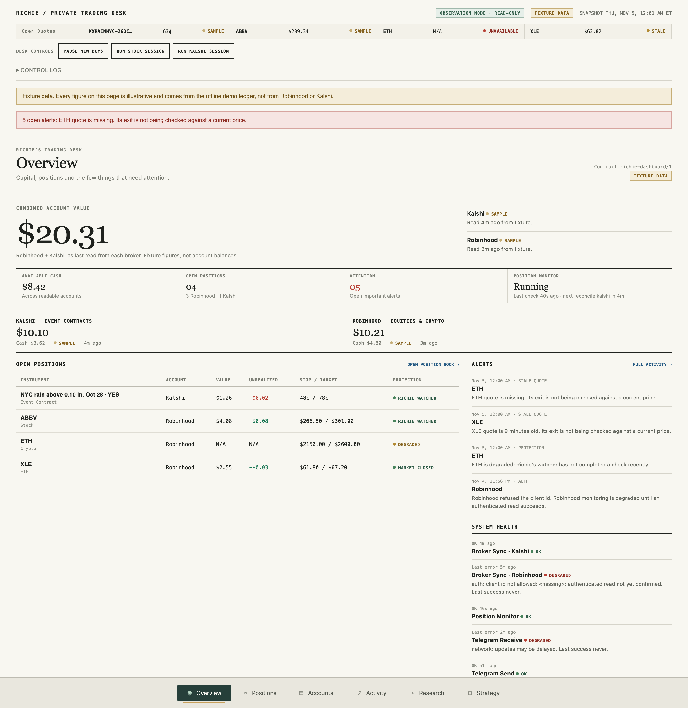
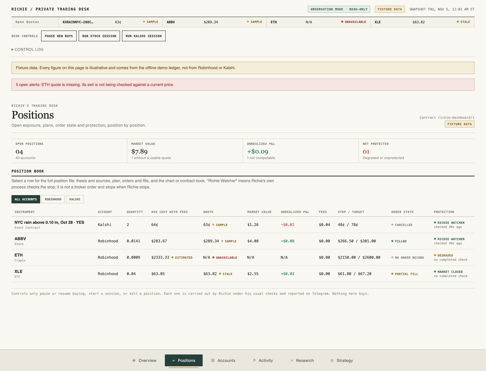
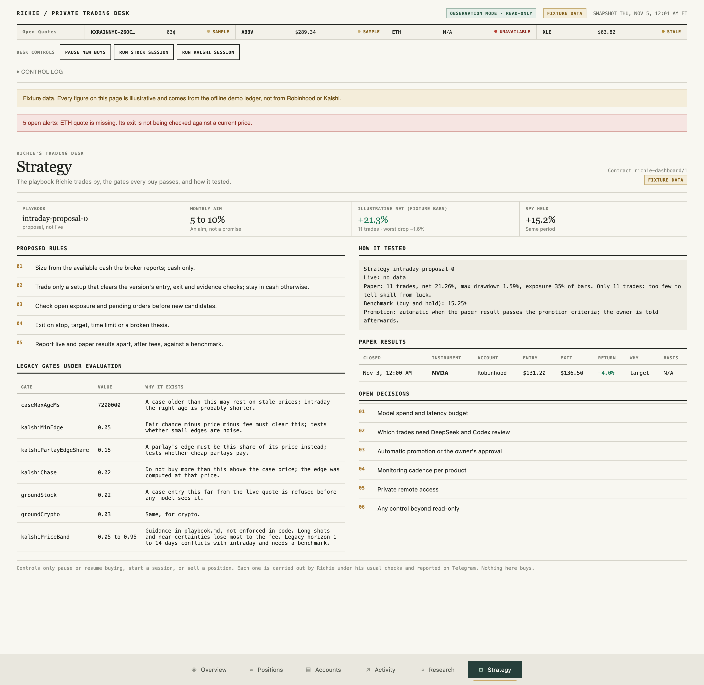

# Richie: a personal AI trading agent

Richie is an AI trading agent I am building as a personal project. He runs on your own computer and trades two small
accounts that you own: a Robinhood Agentic account (stocks, ETFs and crypto) and a Kalshi account (event contracts).
You talk to him through your own Telegram bot, and a local dashboard shows everything he holds and does.

> [!WARNING]
> **Personal project. Use at your own risk.** Richie places real orders with real money. It is not financial advice,
> it comes with no warranty, and it can lose some or all of the money you give it. AI models make mistakes,
> backtests do not predict the future, and this code may have bugs. Start in watch-only mode, use only money you
> can afford to lose, and read the code before you let it trade. See [Disclaimer](#disclaimer).



## What Richie does

- **Trades on a schedule.** A stock session runs at 10:30 am and 3:00 pm on weekdays. Crypto sessions run at 9:00 pm
  Monday, Wednesday and Friday. Kalshi sessions run at noon, 5:00 pm and 10:00 pm every day. All times are US Eastern.
  You can also start a session from Telegram or the dashboard.
- **Researches before every buy.** In a session he reads market data from the broker, searches the web, reads pages in
  a throwaway headless Chrome, and can hand questions to small parallel research workers (capped at $0.25 a day).
  Then he writes a case: entry, stop, target, the reasons and the sources.
- **Has every buy checked twice.** Code checks the case against hard entry gates first. The case is refused if it is
  too old or priced too far from the live quote, or if a Kalshi bet lacks enough edge after fees. Then a second model
  reviews it and must answer PASS.
- **Keeps most of the stock money in SPY, if you want.** You choose how much of the Robinhood account Richie trades
  himself (`RICHIE_TRADING_PERCENT`, 20% by default). Code holds the rest in SPY: it buys from cash, at least $1 at a
  time, and never sells it to fund a trade. Only you sell it, and `core off` stops the buying.
- **Follows a written playbook.** The default (`src/playbook.md`) holds up to 2 momentum trades at a time in his
  share. A stock or ETF exits only on a 20% trailing stop under its highest close, with no target or time limit.
  Crypto keeps a 7% stop and a target. Kalshi bets are sized at a quarter of the Kelly fraction and scaled by how
  well his past predictions were calibrated.
- **Exits in plain code, not with the model.** A monitor checks every open position every minute (every 2 minutes for
  crypto and Kalshi) and sells at the stop or the target. Once a day near the close it raises each trailing stop. It
  never acts on a stale price.
- **Trades Kalshi parlays.** He builds multi-leg NFL combos, asks market makers for a quote (RFQ), and buys only when
  his joint chance beats the quote by a set margin. His method (pricing each leg from the market, injury and weather
  checks, a filter that attacks every reason a leg wins, and correlation) is the included
  [kalshi-parlays skill](src/skills/kalshi-parlays/SKILL.md).
- **Learns every week.** Ideas he passed on are tracked as free paper trades. A weekly review on Sunday scores real and
  paper trades, rewrites his lessons, and proposes rule changes. The changes are never applied without you.
- **Keeps the books.** Every order intent, fill and position is written to a local SQLite ledger and reconciled
  against the broker every minute. The ledger is backed up every 6 hours.
- **Talks like a person.** Ask him anything about his trades, positions or markets on Telegram. He answers with
  look-only tools and messages you unasked only about trades and important alerts.

### What he will not do

He uses cash only: no margin and no borrowing, and an order never exceeds the cash the broker reports. He never
trades options, never moves money in or out, and never cancels orders. Robinhood tools outside a fixed allowlist are
blocked in code. Text in web pages that tries to instruct an AI is flagged and ignored.

## Dashboard

`npm run demo` shows the dashboard with built-in sample data. It needs no accounts and no keys.

| Positions | Strategy |
| --- | --- |
|  |  |

Every figure in these screenshots is sample data from the offline demo, not a real account. The dashboard can pause
buying, start a session, or sell a position, and nothing on it can buy. See [CONTROLS.md](CONTROLS.md).

## Telegram commands

| Command | What it does |
| --- | --- |
| `status` | Account values, positions, scoreboard, month to date against the S&P 500 |
| `menu` | Live panels updated every second: current task, health, a small dashboard |
| `journal`, `kalshi journal` | His recent reasoning and research |
| `run`, `kalshi` | Start a stock or Kalshi session now |
| `pause`, `resume` | Stop or allow new buys (exits keep running) |
| `core off`, `core on` | Stop or restart code's SPY buying (the SPY held stays) |
| anything else | A normal conversation, answered with his look-only tools |

## Requirements

- **Node.js 22.12 or newer.** There are no npm packages to install.
- **macOS, Linux or Windows.** macOS is the most tested platform. On Linux and Windows, set `RICHIE_CHROME` to a Chrome or
  Chromium binary for research pages. Without one he reads pages with plain fetch.
- **A Robinhood account with an Agentic account set up for an external agent**, and/or a **Kalshi account with an API
  key**. You can run with just one of them. Both brokers have their own eligibility rules (US residents, age and
  identity checks, and some Kalshi markets are not offered in every state). Check that you qualify.
- **An OpenRouter API key** for the models (DeepSeek by default, usually a few cents a day).
- **A Telegram bot** (free, from @BotFather) and your own Telegram chat id.

## Setup, step by step

### Option A: let a coding agent set it up

Clone the repo, open it in Claude Code, Codex, Cursor or another coding agent, and say:

> Set up Richie for me by following AGENTS.md. Stop and ask me whenever you need a key, a sign-in or a decision.

[AGENTS.md](AGENTS.md) is written for the agent. It checks your Node version, runs the tests and the demo, then
walks you through each account. You still type every key and approve every sign-in yourself, and the agent
never places a trade. When it finishes, Richie is running in watch-only mode, and you decide when to go live.

### Option B: do it yourself

1. **Get the code and check it works.**

   ```bash
   git clone https://github.com/sachdevaethan5-prog/richie-trading-agent.git && cd richie-trading-agent
   ```

   ```bash
   node --version
   ```

   That must print v22.12 or newer.

   ```bash
   npm test
   ```

   All tests run offline with fake brokers.

2. **Look at the demo dashboard.** Run the command below, open http://127.0.0.1:8792, and stop it with Ctrl+C when
   you are done.

   ```bash
   npm run demo
   ```

3. **Make your settings file.** Copy `.env.example` to `.env`. You fill it in during the next steps. `.env` is
   git-ignored.

   ```bash
   cp .env.example .env
   ```

4. **OpenRouter.** Create a key at https://openrouter.ai/keys, add a few dollars of credit, and put it in
   `RICHIE_OPENROUTER`.

5. **Telegram.**
   1. In Telegram, message @BotFather, send `/newbot`, and put the token it gives you in `RICHIE_TELEGRAM_TOKEN`.
   2. Send your new bot any message. Then open `https://api.telegram.org/bot<token>/getUpdates` in a browser and copy
      the number at `"chat":{"id": ...}` into `RICHIE_TELEGRAM_CHAT_ID`. Richie answers only that chat.

6. **Robinhood (optional if you only use Kalshi).** Set up an Agentic account for an external agent in the Robinhood
   app first (Robinhood's help article "Onboarding an external agent" covers it). Then run the command below, approve
   Richie in the browser window it opens, and fund the Agentic account with the amount you want him to trade.

   ```bash
   npm run signin
   ```

7. **Kalshi (optional if you only use Robinhood).** In Kalshi, go to Account, then API keys, and create a key. Save
   the key id and the downloaded `.key` file. The command below checks the key against your balance and stores it.
   Delete the `.key` file afterwards.

   ```bash
   node src/core/kalshi.mjs --save <key id> <path to the .key file>
   ```

8. **Check everything is found.**

   ```bash
   npm run check
   ```

9. **Watch-only run first.** The command below reads both brokers, runs the monitor and reconcile once, and prints
   a summary. It cannot place an order.

   ```bash
   npm run watch
   ```

10. **Choose Richie's share and read the playbook.** Set `RICHIE_TRADING_PERCENT` in `.env` to the share of the
    Robinhood account Richie trades himself, from 0 to 100 (20 if you leave it out). Code keeps the rest in SPY. A
    bigger share is a bigger bet on Richie: in the long-history test every share trailed holding SPY, and the bigger
    the share the more it trailed. `npm run check` shows the split. `src/playbook.md` is the strategy he follows.
    Change it to fit you before he trades.

11. **Go live.** The command below is the only process that trades. Send `status` to your bot to see him answer.
    Keep it running (in a terminal, `tmux`, a launchd agent on macOS, or a systemd service on Linux).

    ```bash
    npm start
    ```

12. **Open the dashboard.** In a second terminal, run the command below and open http://127.0.0.1:8792.

    ```bash
    npm run dashboard
    ```

To stop buying at any moment, send `pause` to the bot or press Pause on the dashboard. Exits keep running.

## Configuration

Everything is set with environment variables, listed in [.env.example](.env.example). The main ones:

| Variable | Default | What |
| --- | --- | --- |
| `RICHIE_TRADING_PERCENT` | `20` | Share of the Robinhood account Richie trades himself; code holds the rest in SPY |
| `RICHIE_HOME` | `~/.richie` | Ledger, journal, lessons, logs, controls inbox, and secrets on non-Mac systems |
| `RICHIE_MODEL` | `deepseek/deepseek-v4.1-flash` | OpenRouter model for sessions, chat and research |
| `RICHIE_REVIEW_MODEL` | `~deepseek/deepseek-pro-latest` | Model that must PASS every buy and writes the weekly review |
| `RICHIE_CHROME` | macOS Chrome path | Chrome or Chromium binary for reading research pages |
| `RICHIE_SKILLS_DIR` | `src/skills` | Optional skills (see [src/skills/README.md](src/skills/README.md)) |
| `RICHIE_MEMORY_URL` | off | Optional MCP memory server for trade notes and lessons |

Secrets are read from `RICHIE_<NAME>` environment variables first, then the macOS Keychain (service `richie-<name>`),
then `~/.richie/secrets/<name>`. On a Mac you can save them to the Keychain with `node src/setup.mjs <name>` instead
of keeping them in `.env`.

Tunable settings and hard rules live in `src/config.mjs`. The entry gates live in `src/core/lib.mjs` and
`src/strategy.mjs`. The session schedule lives in `src/live-sessions.mjs`.

## Testing the strategy on long history

`npm run backtest` runs Richie's stock rules on up to 27 years of free daily bars (Yahoo, dividend adjusted, cached in
`~/.richie/history`). It needs no account or model and takes about four minutes. Each universe gets 96 variants
(4 entry rules, 6 exit styles, 3 or 5 positions, idle cash held as cash or in SPY), through the same engine and costs
as the dashboard's Strategy page. Three universes are picked without hindsight: the nine original sector ETFs
(1999 on) and about the 20 largest US companies at the end of 2004 and of 2014, each tested only after that date.
The list in `live-sessions.mjs`, picked today, is run beside them to show how much hindsight flatters a backtest.
It also prints a walk-forward check: the best variant on the first half of the data, scored on the second half. Yahoo's
adjusted prices shift by about a millionth between downloads, so a fresh download can move a figure by 0.1 point.
`--refresh` downloads again. Otherwise the cache is reused.

What it showed (November 2026, [full table](docs/history-backtest.md)): the default playbook (momentum entry, 7% stop,
14% target, 20 days, 3 positions, idle cash in cash) ranked 82nd to 94th of 96 and trailed buying and holding SPY by
7 to 10 points a year on every universe picked without hindsight. Letting winners run with a trailing stop did best,
but only about 1 point a year better than SPY on two universes. On the 2014 large caps it was 7 points, all of it
after 2021. The variants that led in the first half did not hold up in the second. So the default now keeps most
of the money in SPY and gives Richie a share with a trailing stop: 80% SPY and 20% Richie trailed SPY by 0.1 to 1.3
points a year, and 35% and 65% by 0.2 to 0.7 over the full periods but 0.7 to 4.7 since 2015. Treat Richie's share as an experiment, not an edge. A strategy version that passes the promotion check in
`config.mjs` is shown to you and goes live only on your approval.

## How it is built

```
src/
  live.mjs            the only process that trades: lease, jobs, Telegram, controls inbox
  runner.mjs          watch-only mode (reads only, never trades)
  live-sessions.mjs   schedule, sessions, chat, research tools, weekly review
  sessions.mjs        the session loop, proposals through gates, sizing and the review model
  execution.mjs       submitOrder and reconcile: every order goes through here
  policy.mjs          order policy: cash only, fresh balance, approved products, pause, holdings
  monitor.mjs         stop and target exits, freshness, job lanes
  ledger.mjs          SQLite ledger (node:sqlite)
  adapters/           Robinhood and Kalshi orders and readers
  core/               broker clients (Robinhood MCP over OAuth, Kalshi signed REST), gates, memory
  server.mjs, dashboard/, controls.mjs, snapshot.mjs   the local dashboard
  playbook.md         the strategy, in plain English
  strategy.mjs, history-backtest.mjs   the backtest engine and the long-history test
tests/                offline tests with fake brokers and captured, anonymized broker responses
```

It is plain Node.js with no dependencies. Models are called through OpenRouter's chat completions API. Robinhood is
reached through its agentic trading MCP server, and Kalshi through its REST API, signed with your key.

## Disclaimer

This is a personal project, shared for learning. Use it at your own discretion and risk.

- **Not financial advice.** Nothing in this repository is investment, financial, legal or tax advice. Richie's
  trades and messages are the output of software and AI models, not recommendations.
- **You can lose money.** Trading stocks, crypto and event contracts is risky. You can lose some or all of what you
  put in. Do not use money you cannot afford to lose.
- **No warranty.** The software is provided "as is", without warranty of any kind (see [LICENSE](LICENSE)). The
  authors are not responsible for your trading results or for any loss, cost or damage from using it.
- **AI can be wrong.** Language models make confident mistakes. Past results and backtests do not predict future
  results.
- **You are responsible.** You are responsible for every order placed with your accounts and keys, for following
  Robinhood's and Kalshi's terms and rules, and for any taxes.
- **Your data goes to the services you configure.** Prompts that include your balances and positions are sent to
  OpenRouter and the model provider you choose. Telegram carries your chat. Read their terms.
- **Not affiliated.** This project is not affiliated with, endorsed by or sponsored by Robinhood Markets, Kalshi,
  OpenRouter, DeepSeek or Telegram. Their names are used only to describe what the software works with. All
  trademarks belong to their owners.
- **Bring your own credentials.** There is no hosted version. Never share your API keys or let anyone else trade
  through your keys.

## Credits

- **[Tyler Bien](https://www.linkedin.com/in/tylerbien/)**, for his in-depth work on the parlay strategy behind the
  [kalshi-parlays skill](src/skills/kalshi-parlays/SKILL.md): pricing legs from the market, the injury and weather
  checks, the filter that attacks every reason a leg wins, and joining legs for correlation.

## License

[MIT](LICENSE). Security reports: see [SECURITY.md](SECURITY.md).
